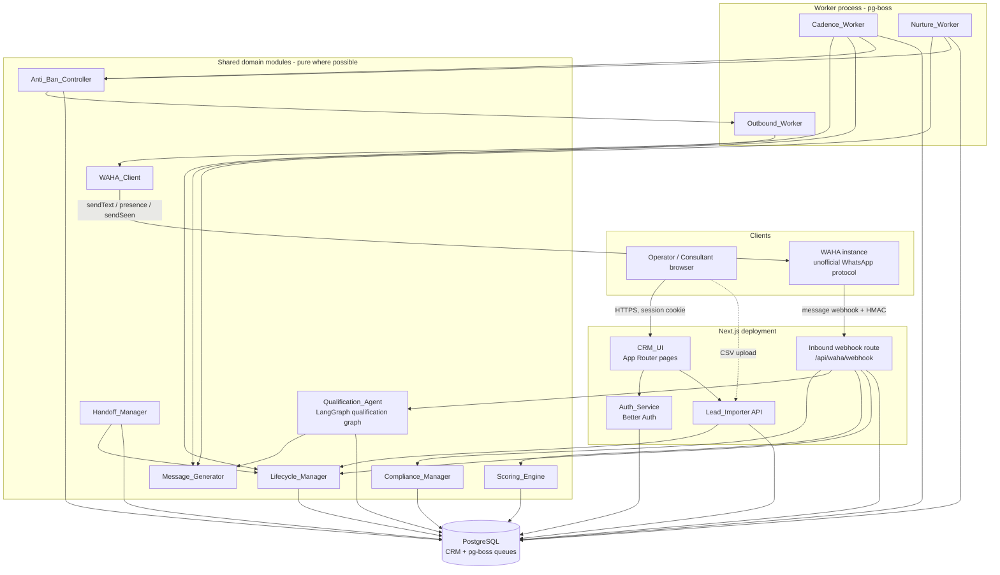
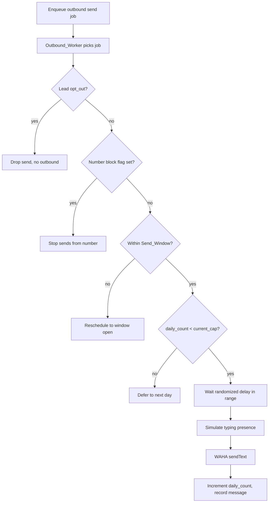
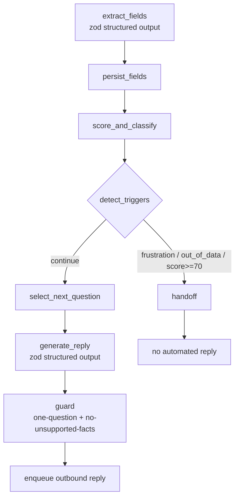
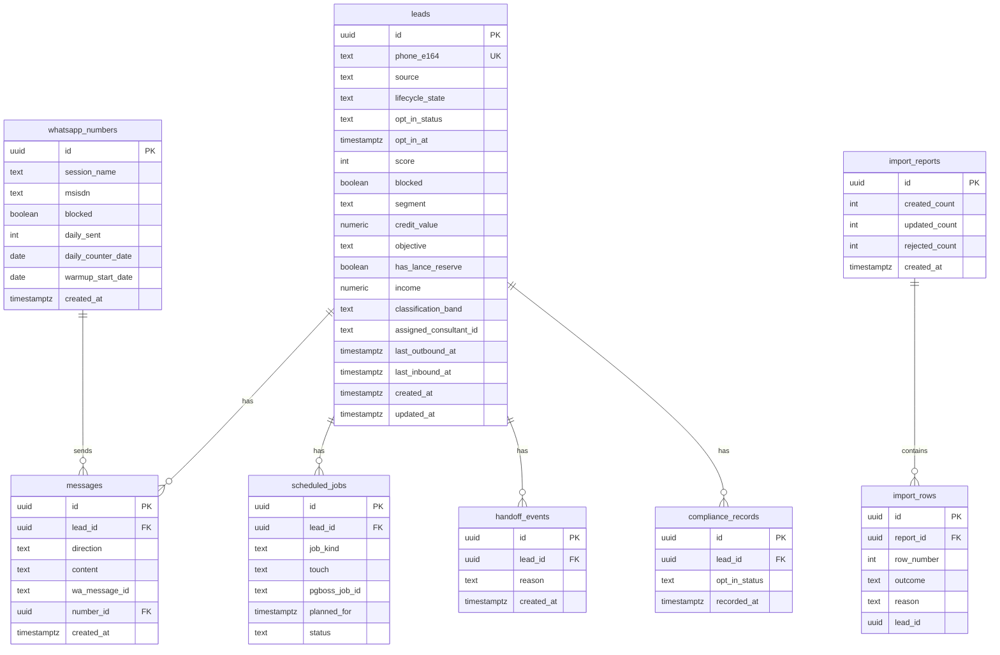
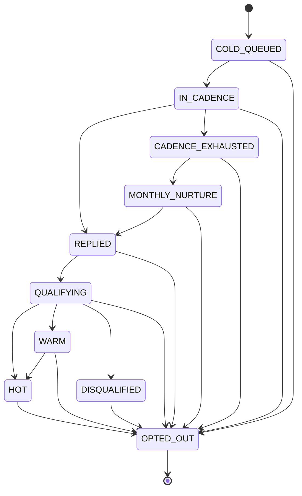

# Design Document

## Overview

This document describes the design for the WhatsApp lead-reactivation agent ("Marko") with an integrated CRM, serving a Brazilian consórcio sales operation. The system ingests cold leads, drives them through a fixed 5-touch / 15-day reactivation cadence, switches to AI-driven conversational qualification the moment a lead replies, scores leads continuously, and hands the hottest leads to a human consultant. It runs continuously at near-zero marginal cost, honors LGPD opt-out, and protects its unofficial WhatsApp numbers from bans.

### Design Goals

- **Source-agnostic intake.** A single `Lead` lifecycle serves CSV today and Meta Ads / landing pages later, with no redesign.
- **Durable, cancellable scheduling.** Every cadence touch and nurture message is a persisted, individually cancellable job. A reply, opt-out, or block must reliably stop pending outreach.
- **State integrity.** Each lead is always in exactly one lifecycle state, and only defined transitions are permitted.
- **Deterministic, testable core logic.** Phone normalization, scoring, classification, state transitions, and anti-ban accounting are pure functions that can be exhaustively property-tested, isolated from I/O.
- **Deliverability safety.** All outbound traffic flows through one choke point that enforces per-number caps, warm-up ramp, randomized pacing, send window, human-like presence, and block detection.

### Technology Decisions

The requirements pin WAHA (WhatsApp), PostgreSQL (data store), and Better Auth (authentication). The remaining choices below are design decisions; they are noted with rationale and can be revisited.

| Concern                | Choice                                                     | Rationale                                                                                                                                                                                                                                                                                                                                                                                                                                                                                                                                                                                                                                                                                    |
| ---------------------- | ---------------------------------------------------------- | -------------------------------------------------------------------------------------------------------------------------------------------------------------------------------------------------------------------------------------------------------------------------------------------------------------------------------------------------------------------------------------------------------------------------------------------------------------------------------------------------------------------------------------------------------------------------------------------------------------------------------------------------------------------------------------------- |
| Language / runtime     | TypeScript on Node.js (>= 20)                              | Better Auth is TypeScript-first; WAHA ships first-class JS/TS examples; one language across UI, API, and workers.                                                                                                                                                                                                                                                                                                                                                                                                                                                                                                                                                                            |
| Web app + API          | Next.js (App Router)                                       | Hosts the minimal CRM_UI, the WAHA webhook route, and internal API in one deployable; integrates cleanly with Better Auth.                                                                                                                                                                                                                                                                                                                                                                                                                                                                                                                                                                   |
| ORM / migrations       | Drizzle ORM                                                | Type-safe schema, SQL-first, lightweight, supported Better Auth adapter.                                                                                                                                                                                                                                                                                                                                                                                                                                                                                                                                                                                                                     |
| Job scheduling         | pg-boss (PostgreSQL-backed queue)                          | Delayed jobs, cron schedules, and per-job cancellation without adding Redis or other infrastructure — keeps marginal cost near zero and reuses the existing PostgreSQL instance.                                                                                                                                                                                                                                                                                                                                                                                                                                                                                                             |
| AI orchestration       | LangChain.js + LangGraph (`@langchain/langgraph`) with zod | The qualification turn is a stateful, multi-step, conditionally-branching flow, which LangGraph models natively as a compiled state graph (extract → persist → score → trigger-detect → question-select → reply → guard) instead of bespoke control flow. zod provides structured-output validation for field extraction and the agent's structured turn output. LangChain.js gives provider-agnostic model bindings (`BaseChatModel`) so the underlying LLM provider can be swapped without touching qualification logic. The compiled graph is wrapped behind a `QualificationAgent` interface with an injectable chat model, preserving a mockable boundary so tests inject a fake model. |
| Property-based testing | fast-check                                                 | De-facto standard PBT library for TypeScript.                                                                                                                                                                                                                                                                                                                                                                                                                                                                                                                                                                                                                                                |
| Test runner            | Vitest                                                     | Fast, native TS/ESM, integrates with fast-check.                                                                                                                                                                                                                                                                                                                                                                                                                                                                                                                                                                                                                                             |

WAHA integration facts that shaped the design (from WAHA docs):

- Outbound text: `POST /api/sendText` with `{ session, chatId, text }`, where `chatId` is `<digits>@c.us`.
- Typing presence: `POST /api/{session}/presence` with `presence: "typing"` / `"paused"` (or `POST /startTyping` / `POST /stopTyping`).
- Read receipts: `POST /api/sendSeen` with `{ session, chatId, messageIds }`.
- Inbound: WAHA delivers a `message` webhook; webhooks support **HMAC (SHA-512)** signing via the `X-Webhook-Hmac` header, plus built-in delivery retries.
- Brazilian caveat: some Brazilian numbers (registered before 2012) need the canonical `chatId` resolved via WAHA's "check phone number exists" endpoint rather than naive `@c.us` concatenation. The `WAHA_Client` resolves and caches the canonical `chatId` per lead. (Content rephrased for compliance with licensing restrictions.)

## Architecture

The system is a single Next.js deployment plus a long-running worker process, both backed by one PostgreSQL database and talking to a self-hosted WAHA instance. The worker and the web app share the same domain modules; only the entry points differ.



### Layering

1. **Pure core (no I/O).** `Lifecycle_Manager` transition function, `Scoring_Engine`, phone normalization, opt-out detection, anti-ban accounting (cap/ramp/delay/window math), and message-template selection are pure functions over plain values. These hold the testable correctness properties.
2. **Domain services (I/O + orchestration).** `Lead_Importer`, `Cadence_Scheduler`, `Inbound_Handler`, `Qualification_Agent`, `Handoff_Manager`, `Nurture_Scheduler`, `Compliance_Manager`, `WAHA_Client`. These read/write PostgreSQL, enqueue/cancel jobs, and run the LangGraph qualification graph and WAHA calls.
3. **Entry points.** Next.js routes/server actions (UI, importer endpoint, webhook) and pg-boss worker handlers (cadence, nurture, outbound).

### Outbound choke point

Every outbound message — cadence touch, nurture message, or qualification reply — is enqueued as an **outbound send job**, never sent inline. The `Outbound_Worker` is the only code path that calls `WAHA_Client.sendText`. Before any send it consults the `Anti_Ban_Controller` to (a) check the number's block flag, (b) check the send window, (c) check/increment the per-number daily counter against the current (warm-up-adjusted) cap, and (d) compute a randomized inter-send delay. This guarantees the per-number invariants hold regardless of which feature requested the send.



## Components and Interfaces

All interfaces are described in TypeScript. Pure functions are explicitly marked; everything else may perform I/O.

### Lead_Importer

Parses CSV rows into candidate leads, normalizes phone numbers, deduplicates against existing leads, and produces an import report.

```typescript
interface ImportRowResult {
	rowNumber: number;
	outcome: "created" | "updated" | "rejected";
	reason?: string; // present only when rejected
	leadId?: string;
}

interface ImportReport {
	createdCount: number;
	updatedCount: number;
	rejectedCount: number;
	rows: ImportRowResult[];
}

interface LeadImporter {
	import(csv: Buffer, source: string): Promise<ImportReport>;
}
```

Behavior: each row → `normalizePhone` (pure). On failure, record row number + reason as `rejected` (Req 1.3). On success, look up by normalized number; if found, update and count as `updated` (Req 1.4); else create with `COLD_QUEUED` and count as `created` (Req 1.5). New leads are then enrolled by the `Cadence_Scheduler` (Req 3.1). The same path serves any future source (Req 2.2).

### Phone normalization (pure)

```typescript
// Returns E.164 (e.g. "+5511987654321") or null if not normalizable.
function normalizePhone(raw: string, defaultCountry: "BR"): string | null;
```

Brazilian-aware: strips formatting, applies the `+55` country code when absent, validates digit count, and is idempotent (`normalizePhone(normalizePhone(x)) === normalizePhone(x)` for any already-normalized `x`).

### Cadence_Scheduler / Cadence_Worker

```typescript
interface CadenceSchedule {
	touch: "T1" | "T2" | "T3" | "T4" | "T5";
	offsetDays: number; // 0, 3, 7, 11, and 14..15 for T5
	jobId: string; // persisted for cancellation
}

interface CadenceScheduler {
	enroll(leadId: string, enrolledAt: Date): Promise<CadenceSchedule[]>; // creates 5 jobs, sets IN_CADENCE
	cancelAll(leadId: string): Promise<number>; // returns count cancelled
}

// Pure: maps a touch + enrollment time to a fire time.
function plannedFireTime(touch: Touch, enrolledAt: Date): Date;
```

The `Cadence_Worker` handles each touch job. On execution it **re-reads** the lead's current state and block flag (Req 5.1) before doing anything (the State Guard, below).

### State Guard (pure predicate + worker step)

```typescript
type GuardDecision = "send" | "skip_and_cancel";

// Pure decision over the freshly-read lead snapshot.
function evaluateSendGuard(lead: LeadSnapshot): GuardDecision;
```

Returns `skip_and_cancel` when the lead's state is any of `REPLIED`, `QUALIFYING`, `HOT`, `WARM`, `DISQUALIFIED`, `OPTED_OUT`, or the block flag is set, or `Opt_In_Status` is `opt_out` (Req 5.2–5.4). The worker then cancels remaining cadence jobs.

### Inbound_Handler

```typescript
interface InboundMessage {
	from: string; // raw WhatsApp sender id, normalized to E.164 internally
	text: string;
	receivedAt: Date;
	waMessageId: string;
}

interface InboundHandler {
	handle(msg: InboundMessage): Promise<void>;
}
```

Pipeline (ordered): identify lead by normalized number (Req 7.1), create one if none exists (Req 7.5); persist inbound message (Req 7.4); `WAHA_Client.sendSeen` (Req 17.3); run `Compliance_Manager.detectOptOut` (Req 15.1) — if opt-out, transition to `OPTED_OUT` and cancel outreach and stop; otherwise cancel pending cadence/nurture jobs (Req 7.2, 6.4); transition `IN_CADENCE`/`MONTHLY_NURTURE` → `REPLIED` → `QUALIFYING` (Req 7.3, 6.4); extract fields (Req 9.2), recompute score (Req 11.1), classify (Req 12), and hand off if hot (Req 13.1).

### Qualification_Agent ("Marko")

The qualification turn is modeled as a **compiled LangGraph state graph** (`@langchain/langgraph`) rather than a single model call. The graph holds the turn state (inbound text, the Lead's current qualification fields, extracted fields, the candidate reply, detected triggers) and advances it through typed nodes connected by conditional edges. An injectable LangChain.js `BaseChatModel` is bound into the graph, so tests can compile the same graph against a fake chat model with no live LLM.

```typescript
import { z } from "zod";
import type { BaseChatModel } from "@langchain/core/language_models/chat_models";

// zod schema for the fields the Lead may volunteer in a turn (Req 9.2).
const ExtractedFieldsSchema = z.object({
	segment: z.string().nullable().optional(),
	creditValue: z.number().nullable().optional(),
	objective: z.enum(["housing", "investment"]).nullable().optional(),
	hasLanceReserve: z.boolean().nullable().optional(),
	income: z.number().nullable().optional(),
});
type ExtractedFields = z.infer<typeof ExtractedFieldsSchema>;

// zod schema for the structured agent output produced by the reply node.
const AgentOutputSchema = z.object({
	reply: z.string(), // at most one question after the guard (Req 8.4)
	detectedFrustration: z.boolean(), // Req 8.5
	outOfDataRequest: z.boolean(), // Req 8.3
	asksAreYouAI: z.boolean(), // Req 8.2
	assertedFacts: z.array(z.string()), // factual tokens the reply asserts, for the guard (Req 8.6)
});
type AgentOutput = z.infer<typeof AgentOutputSchema>;

// LangGraph turn state threaded through the nodes.
interface TurnState {
	leadId: string;
	inboundText: string;
	currentFields: QualificationFields; // already-known field set
	extracted: ExtractedFields; // filled by extract_fields
	nextField: keyof QualificationFields | null; // chosen by select_next_question
	candidate: AgentOutput; // produced by generate_reply
	handoffReason: "frustration" | "out_of_data" | "hot_score" | null;
}

// Mockable boundary: the compiled graph is hidden behind this interface; the
// LangChain.js chat model is injected so the graph runs against a fake in tests.
interface QualificationAgent {
	nextTurn(leadId: string, inbound: InboundMessage): Promise<void>;
}

function buildQualificationGraph(deps: {
	model: BaseChatModel; // injectable; a fake ChatModel in tests
	leads: LeadRepository;
	scoring: ScoringEngine;
	lifecycle: LifecycleManager;
	handoff: HandoffManager;
}): QualificationAgent;
```

The compiled graph wires these nodes:

- **`extract_fields`** — a structured-output LLM call (LangChain `model.withStructuredOutput(ExtractedFieldsSchema)`) that captures every qualification field the Lead volunteered this turn (Req 9.2).
- **`persist_fields`** — writes the extracted values onto the Lead progressively; a field already set is never cleared by an extraction that omits it (Req 9.4, 9.5).
- **`score_and_classify`** — recomputes the Score via `Scoring_Engine` and classifies the band (Req 11.1, 12).
- **`detect_triggers`** — evaluates frustration, an out-of-data factual request, and `score >= 70`; each is a **conditional edge** routing to the `handoff` node (Req 8.3, 8.5, 13.1).
- **`select_next_question`** — chooses a single field that is still `null`, or selects none when all fields are filled (Req 9.3).
- **`generate_reply`** — a structured-output LLM call (`model.withStructuredOutput(AgentOutputSchema)`) producing the "Marko" persona reply carrying at most one question (Req 8.1, 8.2, 8.4).
- **`guard`** — a post-processing honesty/one-question guard that repairs or rejects any reply containing more than one question, or asserting consórcio rate/group/contemplation facts whose tokens are absent from the Lead's available data (Req 8.4, 8.6).
- **`handoff`** — invokes `Handoff_Manager` with the triggering reason and **short-circuits** the reply path so no automated message is sent when a trigger or hot score fires (Req 8.3, 8.5, 13.1, 13.4).



The persona, honesty rules, and "one question per message" constraint are enforced both by the node prompts **and** by the `guard` node, so a model reply that contains more than one question, or that asserts rates/group/contemplation facts not present in the supplied data, is repaired or rejected before it can be sent (Req 8.6). Frustration or an out-of-data request routes through the `handoff` node to `Handoff_Manager` (Req 8.3, 8.5).

### Message_Generator (pure selection + render)

```typescript
interface MessageGenerator {
	renderTouch(touch: Touch, lead: LeadView): string; // T1..T5 templates (Req 4.1-4.5)
	renderNurture(lead: LeadView): string;
}
```

Touch templates are purpose-built per touch; T1 is personalized from the lead's collected data so output differs per lead (Req 4.7, 7-of-Req-4). Rendering is a pure function of `(touch, lead data)`.

### Scoring_Engine (pure)

```typescript
interface ScoringSignals {
	allQuestionsAnswered: boolean; // +20
	incomeCompatible: boolean; // +25
	hasLanceReserve: boolean; // +20
	clearObjective: boolean; // +15
	repliedWithin10Min: boolean; // +10
	repliedInSendWindow: boolean; // +5
	mobileNonVoip: boolean; // +5
	disqualifying: boolean; // income incompatible OR no real interest -> force 0
}

interface BehavioralSignals {
	repliedWithin2Min: boolean; // +10
	askedAboutGroupsOrLance: boolean; // +10
	mentionedUrgentDeadline: boolean; // +15
}

function computeBaseScore(s: ScoringSignals): number; // 0..100
function applyBehavioral(base: number, b: BehavioralSignals): number; // capped at 100
```

### Lifecycle_Manager (pure transition + persistence wrapper)

```typescript
type LifecycleState =
	| "COLD_QUEUED"
	| "IN_CADENCE"
	| "REPLIED"
	| "QUALIFYING"
	| "HOT"
	| "WARM"
	| "DISQUALIFIED"
	| "CADENCE_EXHAUSTED"
	| "MONTHLY_NURTURE"
	| "OPTED_OUT";

type TransitionResult =
	| { ok: true; from: LifecycleState; to: LifecycleState }
	| { ok: false; reason: "invalid_transition"; state: LifecycleState };

// Pure: validates a requested transition against the transition table.
function transition(from: LifecycleState, to: LifecycleState): TransitionResult;

interface LifecycleManager {
	apply(leadId: string, to: LifecycleState): Promise<TransitionResult>; // persists only when ok
}
```

The transition table is the single source of truth for Req 14 (see State Machine below).

### Compliance_Manager (pure detection + persistence)

```typescript
function detectOptOut(text: string): boolean; // pure (PT-BR opt-out phrases)

interface ComplianceManager {
	applyOptOut(leadId: string, at: Date): Promise<void>; // sets opt_out, OPTED_OUT, cancels outreach (Req 15)
	recordLawfulBasis(
		leadId: string,
		status: OptInStatus,
		at: Date,
	): Promise<void>;
}
```

### Anti_Ban_Controller (pure accounting + persistence)

```typescript
interface NumberState {
	numberId: string;
	blocked: boolean;
	dailySent: number;
	warmupStartDate: Date;
}

interface AntiBanConfig {
	baseDailyCap: number;
	warmupInitialCap: number;
	warmupRampDays: number;
	delayMinMs: number;
	delayMaxMs: number;
	sendWindow: { startHour: number; endHour: number }; // local tz
}

// Pure accounting:
function currentDailyCap(cfg: AntiBanConfig, dayInRamp: number): number; // warm-up ramp (Req 16.3,16.4)
function canSend(
	cfg: AntiBanConfig,
	n: NumberState,
	dayInRamp: number,
	now: Date,
): SendDecision;
function nextDelayMs(cfg: AntiBanConfig, rng: () => number): number; // within [min,max] (Req 17.1)
function withinSendWindow(cfg: AntiBanConfig, now: Date): boolean; // Req 17.4

type SendDecision = "allow" | "defer_cap" | "defer_window" | "blocked";
```

### WAHA_Client

```typescript
interface WahaClient {
	resolveChatId(e164: string): Promise<string>; // handles BR pre-2012 numbers
	sendText(
		numberId: string,
		chatId: string,
		text: string,
	): Promise<{ waMessageId: string }>;
	startTyping(numberId: string, chatId: string): Promise<void>;
	stopTyping(numberId: string, chatId: string): Promise<void>;
	sendSeen(
		numberId: string,
		chatId: string,
		messageIds: string[],
	): Promise<void>;
}
```

### Handoff_Manager, Nurture_Scheduler, Auth_Service

```typescript
interface HandoffManager {
	handoff(
		leadId: string,
		reason: "hot_score" | "frustration" | "out_of_data",
	): Promise<void>;
}

interface NurtureScheduler {
	startMonthly(leadId: string): Promise<void>; // MONTHLY_NURTURE + recurring monthly job (Req 6.2,6.3)
	cancel(leadId: string): Promise<void>;
}

// Auth_Service is Better Auth: session cookie guard on every CRM_UI page and data endpoint (Req 21).
```

## Data Models

PostgreSQL via Drizzle. Better Auth owns its own tables (`user`, `session`, `account`, `verification`); pg-boss owns its queue tables in a `pgboss` schema. The application tables below live in the default schema.



### Key model notes

- **`leads.phone_e164` is unique** — enforces deduplication at the database level in addition to the importer's lookup (Req 1.4, 2.2).
- **Qualification fields are nullable** (`segment`, `credit_value`, `objective`, `has_lance_reserve`, `income`) so they fill progressively across messages (Req 9.4, 19.2).
- **`lifecycle_state` and `opt_in_status`** are constrained to their enum values; a check constraint and the `Lifecycle_Manager` together guarantee exactly one valid state (Req 14.1, 19.1).
- **`scheduled_jobs`** mirrors pg-boss job ids so the app can cancel a lead's pending touches/nurture by lead id (Req 3.4, 7.2). `status` ∈ `pending | done | cancelled | skipped`.
- **`whatsapp_numbers`** holds per-number anti-ban state: `blocked` flag (Req 18), `daily_sent` + `daily_counter_date` for the daily cap (Req 16), and `warmup_start_date` for the ramp (Req 16.3).
- **`messages`** records direction (`inbound | outbound`), content, and timestamp for full history (Req 19.3), and the sending `number_id` for outbound.
- **`compliance_records`** is an append-only lawful-basis log (Req 15.4); the current value is also denormalized onto `leads.opt_in_status` / `opt_in_at`.
- **Classification band** (`hot | warm | cold | disqualified`) is stored for "cold within qualification" (Req 12.3), which is a band label while the lead remains `QUALIFYING` (it is not a separate lifecycle state).

### Lifecycle State Machine

The `Lifecycle_Manager` enforces this transition table. Any requested transition not in the table is rejected, leaving state unchanged (Req 14.5).



Notes reconciling the requirements:

- The primary path and the parallel cadence-exhaustion path come directly from Req 14.2.
- `MONTHLY_NURTURE --> REPLIED --> QUALIFYING` implements Req 6.4 (a nurtured lead that replies re-enters qualification).
- `WARM --> HOT` implements Req 13.1 (a rising score promotes to hot "regardless of current funnel stage").
- `* --> OPTED_OUT` from every state implements Req 14.3; `OPTED_OUT` is terminal (Req 14.4).

## Correctness Properties

_A property is a characteristic or behavior that should hold true across all valid executions of a system — essentially, a formal statement about what the system should do. Properties serve as the bridge between human-readable specifications and machine-verifiable correctness guarantees._

The properties below were derived from the prework analysis of the acceptance criteria. Criteria classified as EXAMPLE, SMOKE, or pure UI/auth integration are covered by example/integration tests in the Testing Strategy rather than by properties. Redundant criteria were consolidated (e.g., the four dynamic-scoring rules collapse into one additive-plus-cap property; the four classification bands collapse into one partition property).

### Property 1: Phone normalization yields valid E.164 and is idempotent

_For any_ raw phone string, if `normalizePhone` returns a non-null value then that value matches the E.164 format, and normalizing an already-normalized value returns it unchanged (`normalizePhone(normalizePhone(x)) === normalizePhone(x)`).

**Validates: Requirements 1.2**

### Property 2: Import report accounting is complete and consistent

_For any_ CSV input, the import report satisfies `createdCount + updatedCount + rejectedCount == number of data rows`, every row appears exactly once with an outcome, every rejected row carries its row number and a non-empty reason, and no rejected row produces a Lead.

**Validates: Requirements 1.1, 1.3, 1.6**

### Property 3: Created leads are deduplicated and start COLD_QUEUED with their source

_For any_ set of importable rows, after import every distinct normalized phone number corresponds to exactly one Lead (rows whose normalized number collides are counted as updates, never duplicated), every newly created Lead has `lifecycle_state == COLD_QUEUED`, and every created Lead records the originating source provided to the create path (regardless of which source path is used).

**Validates: Requirements 1.4, 1.5, 2.1, 2.2**

### Property 4: Enrollment sets IN_CADENCE and creates five cancellable touches

_For any_ `COLD_QUEUED` Lead, enrollment transitions the Lead to `IN_CADENCE` and creates exactly five persisted, cancellable jobs labeled T1 through T5; and `cancelAll` subsequently leaves zero pending cadence jobs for that Lead.

**Validates: Requirements 3.1, 3.2, 3.4**

### Property 5: Cadence fire times follow the fixed offsets and are strictly increasing

_For any_ enrollment time, `plannedFireTime` schedules T1 at day 0, T2 at day 3, T3 at day 7, T4 at day 11, and T5 within the day 14–15 interval relative to enrollment, and the five fire times are strictly increasing in touch order.

**Validates: Requirements 3.3**

### Property 6: Touch templates are distinct and T1 is per-lead personalized

_For any_ Lead, each touch T1–T5 renders non-empty text, the five touch templates are pairwise distinct, and _for any_ two Leads whose personalization-relevant collected data differ, the rendered T1 messages differ.

**Validates: Requirements 4.7**

### Property 7: Send guard stops outreach exactly on the defined stop conditions

_For any_ Lead snapshot read at touch execution time, `evaluateSendGuard` returns `skip_and_cancel` if and only if the Lead's state is one of `REPLIED`, `QUALIFYING`, `HOT`, `WARM`, `DISQUALIFIED`, `OPTED_OUT`, or the block flag is set, or `Opt_In_Status` is `opt_out`; otherwise it returns `send` (so a Lead reaching T5 with no reply, opt-out, or block is sent T5).

**Validates: Requirements 4.6, 5.2, 5.3, 5.4**

### Property 8: Cadence exhaustion flows into monthly nurture at a one-month interval

_For any_ `IN_CADENCE` Lead that completes T5 without replying, the resulting state is `CADENCE_EXHAUSTED`, then `MONTHLY_NURTURE` with a recurring job, and _for any_ nurture start date the next scheduled nurture date is exactly one calendar month later (correctly handling month-length edges such as Jan 31 → Feb).

**Validates: Requirements 6.1, 6.2, 6.3**

### Property 9: An inbound reply cancels pending outreach and advances to qualification

_For any_ Lead in `IN_CADENCE` or `MONTHLY_NURTURE` with pending scheduled jobs, handling an inbound (non-opt-out) message cancels all remaining cadence/nurture jobs for that Lead (zero pending afterward) and advances the Lead through `REPLIED` to `QUALIFYING`.

**Validates: Requirements 6.4, 7.2, 7.3**

### Property 10: Inbound messages are attributed by normalized number and never lost

_For any_ inbound message, the handler resolves the Lead whose normalized E.164 number matches the sender (creating a new Lead when none matches), and the message is persisted in that Lead's history with identical content and receipt timestamp (round trip).

**Validates: Requirements 7.1, 7.4, 7.5**

### Property 11: Behavioral triggers route a Lead to handoff

_For any_ turn whose agent graph output has `detectedFrustration` true or `outOfDataRequest` true, the `detect_triggers` node routes to the `handoff` node so `Handoff_Manager` is invoked for that Lead, and when `outOfDataRequest` is true the reply path is short-circuited so no unsupported factual claim is sent in that turn.

**Validates: Requirements 8.3, 8.5**

### Property 12: Outbound replies never assert unsupported facts or exceed one question

_For any_ candidate agent reply passed through the outbound honesty/format guard, the emitted text contains at most one question sentence, and contains no consórcio rate, group, or contemplation-outcome claim whose tokens are absent from the Lead's available data.

**Validates: Requirements 8.4, 8.6**

### Property 13: Field extraction persists progressively and monotonically

_For any_ fields extracted by the `extract_fields` node, every provided field value is persisted on the Lead by `persist_fields` and readable back unchanged; and _for any_ sequence of partial extractions, once a qualification field is set it is never cleared by a later extraction that omits it (unset fields remain null until volunteered).

**Validates: Requirements 9.2, 9.4, 9.5**

### Property 14: The next qualification question targets only unfilled fields

_For any_ Lead with a partially filled qualification field set, the field chosen for the next question is one that is currently null, or no question is asked when all fields are filled.

**Validates: Requirements 9.3**

### Property 15: Base score equals the sum of satisfied weights, with disqualification forcing zero

_For any_ combination of scoring signals, `computeBaseScore` returns a value in the inclusive range 0–100; when no signal holds the result is 0; when `disqualifying` holds (income incompatible or no real interest) the result is exactly 0; otherwise the result equals the sum of the weights whose conditions hold (+20 all answered, +25 income compatible, +20 lance reserve, +15 clear objective, +10 replied within 10 min, +5 replied in window, +5 mobile non-VoIP).

**Validates: Requirements 10.1, 10.2, 10.3, 10.4**

### Property 16: Behavioral additions are additive and capped at 100

_For any_ base score in 0–100 and any behavioral signals, `applyBehavioral` returns `min(100, base + 10·[replied within 2 min] + 10·[asked about groups/lance] + 15·[mentioned urgent deadline])`.

**Validates: Requirements 11.2, 11.3, 11.4, 11.5**

### Property 17: Classification partitions the score range exactly

_For any_ score in 0–100, classification returns `HOT` when score ≥ 70, `WARM` when 40 ≤ score ≤ 69, `cold` (within qualification) when 1 ≤ score ≤ 39, and `DISQUALIFIED` when score is 0; the bands are exhaustive and mutually exclusive.

**Validates: Requirements 12.1, 12.2, 12.3, 12.4**

### Property 18: Crossing 70 forces immediate handoff and HOT, then silences automation

_For any_ current lifecycle state and any newly computed score ≥ 70, the Lead is handed off to a Consultant immediately and transitions to `HOT`, a handoff event recording the triggering reason is persisted, and after handoff no further automated outbound message is enqueued or sent for that Lead.

**Validates: Requirements 13.1, 13.2, 13.4**

### Property 19: Lifecycle transitions are valid exactly when defined, and OPTED_OUT is terminal

_For any_ pair of states `(from, to)`, `transition(from, to)` succeeds if and only if `(from, to)` is in the transition table; a transition to `OPTED_OUT` is permitted from every non-terminal state; no transition out of `OPTED_OUT` is permitted; and applying an undefined transition leaves the persisted state unchanged. After any sequence of transition attempts, the Lead holds exactly one valid lifecycle state.

**Validates: Requirements 14.1, 14.2, 14.3, 14.4, 14.5**

### Property 20: Opt-out is detected, recorded, and immediately silences all outreach

_For any_ inbound message containing an opt-out request, `detectOptOut` returns true and applying opt-out sets `Opt_In_Status` to `opt_out`, transitions the Lead to `OPTED_OUT`, cancels all scheduled outreach (zero pending afterward), appends a lawful-basis compliance record with the status value and timestamp, and thereafter no outbound message is ever sent to that Lead.

**Validates: Requirements 15.1, 15.2, 15.3, 15.4**

### Property 21: Per-number daily cap is never exceeded and the warm-up ramp is monotonic

_For any_ anti-ban configuration and any sequence of send requests against a single number, the number's daily sent count never exceeds its current daily cap (`canSend` returns `defer_cap` once the count reaches the cap); and the current daily cap is non-decreasing in the day-within-ramp, equal to the configured initial cap on day 0 and equal to the base cap once the ramp period has elapsed.

**Validates: Requirements 16.1, 16.2, 16.3, 16.4, 16.5**

### Property 22: Send pacing stays within the configured delay range and send window

_For any_ random draw, `nextDelayMs` falls within the configured `[delayMin, delayMax]` range; and _for any_ timestamp, a send is allowed only when the timestamp is within the configured Send_Window (otherwise `canSend` returns `defer_window`).

**Validates: Requirements 17.1, 17.4**

### Property 23: A blocked number is fully silenced

_For any_ number whose block flag is set, `canSend` returns `blocked`, the outbound worker performs no WAHA send from that number, and the scheduler assigns zero new outbound sends to that number.

**Validates: Requirements 18.2, 18.3**

### Property 24: CRM persistence round-trips lead, qualification, and message data

_For any_ Lead with arbitrary core fields, nullable qualification fields, and message history, persisting and reloading returns identical values (set fields preserved, nulls preserved, message direction/content/timestamp preserved); and any update to score or lifecycle state is reflected on reload.

**Validates: Requirements 19.1, 19.2, 19.3, 19.4**

## Error Handling

### Inbound webhook (WAHA → system)

- **Authentication.** The webhook route verifies the `X-Webhook-Hmac` (SHA-512) signature against the configured shared secret before processing. Invalid or missing signatures are rejected with `401` and not processed. The body is treated as untrusted input and validated against a schema before use.
- **Idempotency.** WAHA retries failed webhook deliveries. Each inbound is keyed by `wa_message_id`; a duplicate delivery is recognized and acknowledged without re-running side effects (no double scoring, no double cancellation). The handler is therefore safe under at-least-once delivery.
- **Fast acknowledgement.** The route persists the raw inbound and enqueues processing, then returns `2xx` quickly so WAHA does not retry due to timeout. Heavy work (LLM call, scoring, classification) runs in the worker.
- **Unknown sender.** Handled as a normal case (Req 7.5): create the Lead, record the message.

### Outbound send (system → WAHA)

- **Transient WAHA/network errors.** The outbound job retries with exponential backoff (pg-boss retry policy). Retries do not increment the per-number daily counter more than once for a single logical send: the counter is incremented only on confirmed send, inside the same transaction that records the message.
- **Cap / window / block deferral.** `defer_cap` reschedules the job to the next day; `defer_window` reschedules to the next window open; `blocked` removes the job from that number and (where another healthy number is available) reassigns it, otherwise parks it. None of these are treated as failures.
- **Permanent send failure (e.g., invalid chatId).** After exhausting retries the job is moved to a dead-letter state and surfaced in the CRM_UI; the Lead is not advanced as if the message were delivered.
- **Block detection.** A send response or session signal indicating the number is blocked sets the number's block flag (Req 18.1), which then trips Property 23 for all subsequent sends.

### LLM / Qualification_Agent

- **Model unavailable or timeout.** The qualification turn fails closed: no outbound is sent, the inbound remains recorded, and the graph run is retried; repeated failure surfaces the Lead for manual attention rather than sending a degraded message.
- **Malformed model output.** Each structured-output node parses the model response against its zod schema (`ExtractedFieldsSchema`, `AgentOutputSchema`); on parse failure the turn is retried, and the `guard` node (Property 12) rejects any reply that violates the one-question or no-unsupported-facts rules before it can be sent.

### Scheduling and state

- **Lost race between reply and touch.** The State Guard (Property 7) re-reads fresh state at execution time, so a touch that races with an inbound reply is skipped and remaining jobs cancelled. State writes use optimistic concurrency (compare-and-set on `lifecycle_state`/`updated_at`) so concurrent transitions cannot corrupt the single-state invariant (Property 19).
- **Invalid transition requests.** Rejected by the `Lifecycle_Manager` with state left unchanged (Property 19); these are logged for diagnostics, not raised to the user.

### Import

- **Malformed CSV / encoding issues.** Rows that cannot be parsed or whose phone cannot be normalized are rejected with a recorded reason (Property 2); a single bad row never aborts the whole import.

### Authentication

- Unauthenticated or expired sessions are denied and redirected by Better Auth before any Lead data is read (Req 21). Authorization failures return `401`/`403` and are logged.

## Testing Strategy

### Approach

The system is tested with a complementary mix:

- **Property-based tests (fast-check, Vitest)** verify the universal properties above against the pure core (normalization, scoring, classification, lifecycle transitions, anti-ban accounting, send guard, opt-out, scheduling math) and against the orchestration logic using in-memory or mocked repositories.
- **Example-based unit tests** cover specific scenarios and criteria classified as EXAMPLE/EDGE_CASE: persona honesty replies (8.2), single re-engagement opener (9.1), typing-before-send ordering (17.2), seen-on-inbound (17.3), block-flag-on-detection (18.1), and the day-0 ramp boundary (16.4).
- **Integration tests** cover I/O seams with a real PostgreSQL (via testcontainers or a disposable schema): Drizzle persistence round-trips, pg-boss enqueue/cancel/recurring behavior, the webhook route (HMAC verification + idempotency), and Better Auth route protection (21.1–21.3).
- **Component/UI tests** cover the CRM_UI rendering criteria (20.1–20.4) — lead list with state/score, lead detail with fields and history, import report display, and the handoff view.

### Property-Based Testing Requirements

- Use **fast-check** as the PBT library; do not hand-roll property testing.
- Each property test runs a **minimum of 100 iterations** (`fc.assert(..., { numRuns: 100 })` or higher).
- Each property test is tagged with a comment referencing its design property, in the format:
  **Feature: whatsapp-lead-reactivation-agent, Property {number}: {property_text}**
- Each of Properties 1–24 is implemented by a **single** property-based test.
- Generators must include the edge cases identified in prework: all-false scoring signals (10.3), the disqualifying override (10.4), score boundaries 0/1/39/40/69/70/100 (Property 17), month-length boundaries for nurture dates (Property 8), day-0 and post-ramp days for the warm-up cap (Property 21), and timestamps inside/outside the send window (Property 22). Phone generators must include Brazilian formats, non-numeric junk, and already-normalized E.164 values (Properties 1, 10).

### Isolating the pure core

To keep property tests fast and deterministic (and to satisfy the "do not run 100 live WAHA/LLM calls" guidance), the I/O collaborators are abstracted behind interfaces (`WahaClient`, repositories, a `clock`, and an injectable `rng`), and the qualification graph is compiled against an injectable LangChain.js chat model. Property tests compile the same LangGraph graph with a **fake `ChatModel`** (returning canned structured outputs) so the extract → persist → score → trigger → question → reply → guard flow runs with no live LLM; the `ExtractedFieldsSchema` / `AgentOutputSchema` zod schemas are validated as part of those runs; and the honesty/one-question `guard` node is property-tested directly over generated candidate replies. Property tests exercise the pure functions and the orchestration/graph logic against in-memory fakes; live WAHA, the real LLM, and CloudWatch-style externals are reserved for a small number of integration/smoke tests, not property tests.

### What is intentionally not property-tested

- WAHA delivery behavior, Better Auth internals, and the LLM's semantic quality are external/third-party and are covered by integration or example tests with a few representative cases, not by 100-iteration properties.
- UI look-and-feel and "feels natural" qualities (e.g., persona warmth) are not computable properties and are validated by example tests and manual review.
